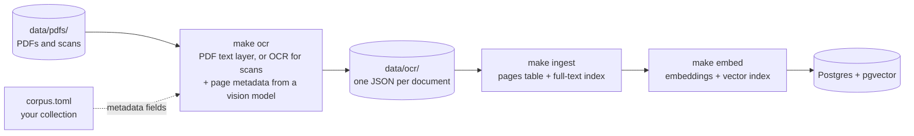
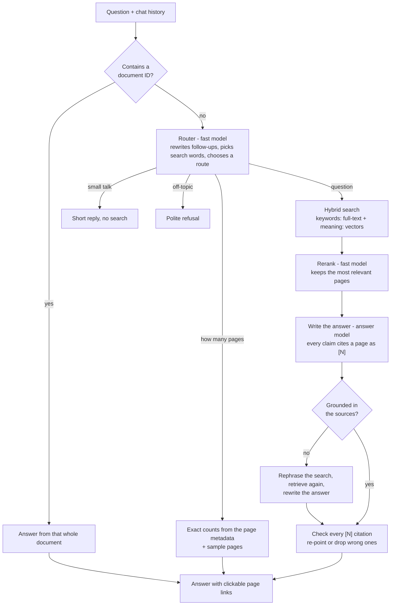

# EvidenceRAG

A question-answering app for your own collection of PDFs. People ask in plain language and get
answers built only from your documents, where every claim cites the exact page it comes from.
Questions outside the collection get a polite refusal instead of an invented answer.

You provide the documents and a short description of them. Everything else is done with `make` commands.

## Quick start

You need: **Python 3.11+**, **Node.js 20+**, **Docker** (for the database), and an API key from
[Groq](https://console.groq.com/keys) (free tier available) or another model provider.

```bash
make setup          # 1. install everything; creates .env -> put your API key in it
make configure      # 2. describe your collection in a form (writes corpus.toml)
                    # 3. copy your PDFs (or scans: png/jpg/tif) into data/pdfs/
make db             # 4. start the database
make ocr            # 5. read every file: text, OCR for scans, page metadata
make ingest         # 6. load the pages into the database
make embed          # 7. prepare meaning-based search
make dev            # 8. open the app at http://localhost:5173
```

Lost? `make status` shows how far along each step is and what to run next. `make` lists every command.

## How it works

**1. Preparing the documents** (once, and again after adding files):



**2. Answering a question:**



The answer is checked before it is shown, so users never see text that later changes. The prompts
(`backend/prompts/*.j2`) are generic and read your collection's details from `corpus.toml`.

## What goes where

| File | What it is | How to fill it |
|---|---|---|
| `data/pdfs/` | Your documents. The file name (without `.pdf`) is the document's ID. | Copy them in |
| `corpus.toml` | Everything about **your collection**: the app's name and welcome text, example questions, what is in scope, search examples, page metadata to extract. | `make configure`, or edit it (see `corpus.example.toml`) |
| `.env` | **Technical settings**: which model provider and models, API keys, OCR engine, database. | Edit it; only block 1 is required |

The app refuses to start while `corpus.toml` still contains a `TODO`, and lists exactly which ones.

## Choosing models

Every model is called through the OpenAI-compatible API, so any provider works. Set `LLM_PROVIDER` in `.env`:

| Provider | Best for | Notes |
|---|---|---|
| `groq` **(default)** | Most projects: fast, cheap, good quality | Defaults: `openai/gpt-oss-120b` (answers), `openai/gpt-oss-20b` (fast tasks), `qwen/qwen3.8-27b` (vision) |
| `openai` | If you already use OpenAI | Set `LLM_MODEL`, `LLM_FAST_MODEL`, `VISION_MODEL` |
| `ollama` | Private or offline documents; no cost | Runs on your computer; slower and somewhat less accurate. `ollama pull` the models first |
| anything else | vLLM, LM Studio, Together, a proxy | Set `LLM_BASE_URL` (and `LLM_API_KEY`) |

There are three model roles: **answers** (writes the replies), **fast** (small JSON tasks: routing,
reranking, answer checks), and **vision** (reads page images during `make ocr`). The vision model
can use a different provider (`VISION_PROVIDER`), e.g. local Ollama for scans and Groq for answers.
Providers retire models over time: `make models` lists what yours offers today.

**Embeddings** (meaning-based search) run locally on your CPU by default: no key, no cost. For
documents that are not in English, set a multilingual model (see `.env.example`) and run `make embed`.

## How `make ocr` reads your files

For every page:

1. **Text**: if the PDF has a text layer (most digital PDFs), it is read directly: exact, free and instant.
   Scanned pages go to `OCR_ENGINE`:
   - `tesseract` (default): local and free. Install with `brew install tesseract` / `apt install tesseract-ocr`.
   - `google`: Google Cloud Vision, the most accurate on old, faded or typewritten scans (paid per page). `make install-google-ocr`.
   - `llm`: the vision model; handles handwriting well.
2. **Metadata**: if `corpus.toml` lists page properties (e.g. *the page is signed*) or document types,
   the vision model labels each page. Users can then ask "how many pages are signed?". Leave them
   empty to skip this step.

Results are saved in `data/ocr/` every few pages: an interrupted run continues where it stopped.
`make ocr FORCE=1` starts over and first moves the old results to `data/backups/`. `make ocr LIMIT=5`
tries the first five files. Added metadata fields later? `make metadata` fills in only those.

## Running it for others

```bash
make up             # production build in Docker: http://localhost:8080
```

- **Hosted database**: set `DATABASE_URL` to any Postgres with the `pgvector` extension (e.g. Supabase), then run `make ingest` and `make embed` against it.
- **Your domain**: set `ALLOWED_ORIGINS` so only your website can use the API.
- **Not included**: sign-in and rate limiting. Anyone who can reach the app can use your model budget, so put it behind your organisation's login or a reverse proxy before making it public.
- **Backups**: `make backup` saves `corpus.toml`, the OCR results and a database dump to `data/backups/`. The database can always be rebuilt with `make ingest` and `make embed`.

## Checking quality

`make test` runs the test suite (offline: no keys or database needed). To measure answer quality on your
own questions, see [eval/README.md](eval/README.md) (`make eval-app`, `make eval`).

## Project layout

```
corpus.toml          your collection (make configure)     corpus.example.toml   a filled-in example
.env                 models, keys, OCR settings           Makefile              every command
data/pdfs/           your documents                       data/ocr/             make ocr results
setup/               the corpus.toml form (make configure)
backend/app/         the web API and answering pipeline   backend/prompts/      prompt templates
backend/ingest/      make ocr / ingest / embed / status   backend/tests/        tests
frontend/            the chat interface (React)           eval/                 quality measurement
```

## Troubleshooting

| Message | Fix |
|---|---|
| `corpus.toml: replace the TODO values in ...` | `make configure`, or fill in those keys |
| `model ... does not exist` / `model_not_found` | The provider retired it: `make models`, then set the model in `.env` |
| `database not reachable` | `make db` (Docker must be running), or check `DATABASE_URL` |
| `tesseract is not installed` | `brew install tesseract`, or choose another `OCR_ENGINE` |
| Answers ignore new documents | `make ocr`, `make ingest`, `make embed` after adding files |
| Search quality dropped after changing `EMBED_MODEL` | `make embed` (it rebuilds automatically) |
